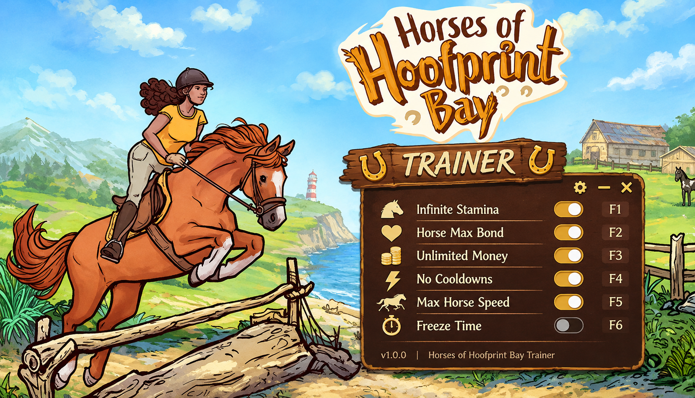

# Horses of Hoofprint Bay — Trainer

**Set savings, unlock every barn upgrade, skip training cooldowns, reveal foal genetics, instant grooming, no vet costs.**
Free, open source, no installer. Opens with `Insert`.

> **[⬇️ Download the latest Horses of Hoofprint Bay trainer](../../releases/latest)**

    

[Hotkeys](#hotkeys) · [Barn stages](#what-each-barn-stage-is-actually-short-of) · [FAQ](#faq)

---

> [!NOTE]
> Single-player only. No multiplayer, no anti-cheat. Nothing here reaches another player's barn.

## Two kinds of trainer

In this game you are already a trainer. You build strength and confidence in a horse until it is ready to qualify, and that is the job the game is about. This is the other kind — a tool that sits outside the game and changes numbers in it — and the two are easy to confuse on a search results page, so it is worth being clear about which one this is and what it leaves alone.

It leaves the horses alone.

Grooming with the brush and hoofpick, catching a saddle sore before it becomes an abscess, deciding whether a mare is ready to be bred and to which stallion, reading whether an exercise built confidence or burned it — all of that is untouched, and none of it has an auto button here. Thogli Studios built a game that horse people vouch for on the strength of exactly those details, and a tool that pressed them for you would be a tool for people who do not want to play it.

What this changes is the barn around the horses: the savings that gate your building upgrades, the stall count, the staff wages, the cooldown between one training session and the next, the vet bill that arrives when you were saving for a paddock.

## The game ships moddable, and that matters here

Hoofprint Bay includes colour tools for characters and tack, and it exposes textures and text files for modding on purpose. That is unusual and it changes what this tool should be: there is no reason to duplicate in memory what the game already lets you edit properly in a file. So you will not find coat-colour or tack-recolour options here — go and use the in-game tools, they are better. What is here is the economy and the clock, which the game does not expose.

If you are modding textures already, the two sit together without conflict. Memory edits and file edits do not overlap.

## Features

**Barn and money**

| Option | Hotkey | What it does |
|---|---|---|
| Set savings | `F1` | Type any figure |
| Savings multiplier on prize money | slider | `1x`–`20x`, default `1x` |
| Free building upgrades | `F2` | Stables, paddocks, wash bay, arena — no cost |
| Unlock all buildings | — | `save` — every upgrade tier available immediately |
| Free staff | `F3` | Hired grooms and trainers draw no wages |
| Staff work speed | slider | `1x`–`10x`, default `2x` |
| Stall limit | slider | `4`–`60` — the hard cap on horses the barn holds |
| No feed or bedding costs | — | Consumables stop drawing down savings |
| No vet bills | `F4` | Treatment is free; injuries still happen and still need treating |

**Horses and care**

| Option | Hotkey | What it does |
|---|---|---|
| Freeze grooming decay | `F5` | Coat, mane and hoof condition hold where you left them |
| No injuries `bypass` | — | Sores, abscesses and scrapes stop occurring — off by default |
| Instant grooming `bypass` | `F6` | Full groom in one click — off by default |
| Energy drain | slider | `0x`–`2x`, default `1x` — how fast a horse tires through a session |
| Instant energy recovery | `F7` | Skip the rest between sessions |
| Set age | slider | Per horse, for breeding windows and retirement |
| Freeze age | — | Stops the calendar ageing your herd |
| Horse happiness | slider | `0`–`100`, set per horse |

**Training and competitions**

| Option | Hotkey | What it does |
|---|---|---|
| No training cooldown | `F8` | Run exercises back to back |
| Training gain | slider | `1x`–`10x`, default `2x` — strength and confidence per session |
| Freeze confidence decay | — | Skipped days stop costing progress |
| Unlock all competitions | — | `save` — enter any tier without qualifying |
| Always qualify `bypass` | — | Skip the qualification requirement entirely — off by default |
| Competition placing | dropdown | Force 1st through 6th, or leave on `natural` |
| Prize money | slider | `1x`–`20x` |
| Trail ride speed | slider | `1x`–`5x` — for the longer routes |

**Breeding**

| Option | Hotkey | What it does |
|---|---|---|
| Reveal foal genetics `spoiler` | `F9` | Shows the likely coat and stat outcome before you commit a pairing |
| No gestation wait | `F10` | Foals arrive on the next day roll |
| Breeding cooldown off | — | A mare can be paired again immediately |
| Force foal traits | dropdown | Pick coat, markings and stat bias directly |
| Unlock all stallions | — | `save` — every stud available at the yard |

**Comfort and display**

| Option | Hotkey | What it does |
|---|---|---|
| Interface scale `comfort` | slider | `100%`–`200%` — the care menus are dense at high resolutions |
| Larger text `comfort` | slider | Independent of interface scale, for the library and tooltips |
| High-contrast condition icons `comfort` | — | Replaces the subtle coat-condition shading with clear markers |
| Skip point-and-click travel `comfort` | — | Jump straight between barn areas |
| Game speed | slider | `0.5x`–`4x` |
| Freeze clock | `F11` | Stop the day advancing |
| Hide HUD | `F12` | For screenshots of the hand-drawn art, which is the point of a lot of this game |

Tags — **`bypass`**: removes the hands-on care the game is built around · **`spoiler`**: reveals an outcome early · **`save`**: writes persistent data · **`comfort`**: accessibility, changes nothing mechanical. Everything tagged `bypass` or `spoiler` ships off.

## Hotkeys

`Insert` opens the menu · `End` resets everything · `F1`–`F12` as above, all rebindable · arrow keys and `Enter` navigate without a mouse

## What each barn stage is actually short of

The barn gates on different things at different sizes, and turning everything on hides which stage you are at. One option usually clears the wall.

| Where you are | What is actually blocking you | Turn on |
|---|---|---|
| First two horses | Nothing — this part is well paced | Nothing |
| Third to sixth horse | Stall space, long before money | Stall limit `12` |
| First real upgrade | Savings, by a wide margin | Free building upgrades |
| Running six-plus horses | Grooming time across the herd | Staff work speed `4x`, free staff |
| Chasing competition tiers | Cooldowns between sessions | No training cooldown |
| Starting to breed | Gestation waits, then foal lottery | No gestation wait |
| Late barn, full roster | Feed, bedding and vet bills compounding | No feed costs, no vet bills |

> [!TIP]
> If you want the game intact but the barn chores lighter: **free building upgrades**, **staff work speed `4x`**, **no training cooldown**, **interface scale `130%`**. Four options. You still groom by hand, still treat injuries, still read a horse's confidence before entering it, still pick the pairing yourself — the barn just stops making you wait between the parts you came for.

> [!WARNING]
> **Instant grooming and No injuries together remove the game.** Hoofprint Bay is a care game. The reason horse people recommend it is that the brush, the hoofpick and the abscess you caught in time behave the way they behave in a real yard. Automate the brush and prevent the injury and what is left is a spreadsheet with lovely drawings attached. Both ship off; please leave them off and use the energy and cooldown sliders instead.
>
> **Reveal foal genetics** is tagged `spoiler` honestly. Planning a pairing and finding out what you got is the whole breeding loop, and the reveal is a one-way door for that save.
>
> Options tagged `save` write persistent data that a patch can invalidate. Back up `%USERPROFILE%\AppData\LocalLow\Thogli Studios\Horses of Hoofprint Bay` first and turn off Steam Cloud while you experiment.

## FAQ

Will I get banned?

No. Single-player, no anti-cheat, no online component. Achievements unlock locally unless you block them in the menu.

How do I get more money in Horses of Hoofprint Bay?

<strong>Set savings</strong> on <code>F1</code> writes any figure directly. If you would rather still earn it, <strong>prize money <code>5x</code></strong> makes local tournaments worth entering for the purse instead of only for the ribbons, and <strong>free building upgrades</strong> removes the biggest single drain without touching your income at all.

Will this conflict with texture mods?

No. The game's modding works through texture and text files on disk; this works in memory while the game runs. They do not touch the same things. Coat and tack colours are deliberately absent here because the game's own colour tools do that job better.

Can I breed for a specific coat colour?

<strong>Force foal traits</strong> sets coat, markings and stat bias directly, and <strong>Reveal foal genetics</strong> shows the likely outcome of a pairing before you commit. Both shortcut the part of the game breeders tend to enjoy most, so consider the reveal first and the force option only if a specific horse is the whole reason you are playing.

Does freezing age stop my horses retiring?

Yes, and it also stops foals growing. If you want a specific horse to stay in work, <strong>Set age</strong> on that one horse is the narrower tool.

Does it work on Steam Deck or Linux?

No. Windows only. Proton changes how the game's memory is laid out and this build does not handle that.

Windows Defender flagged the download.

Trainers read and write another process's memory, which is what a lot of malware also does, so heuristic scanners flag them on principle. Every release ships with a SHA256 checksum and full source. Add an exclusion if you are comfortable with that — and if you would rather not, don't. That is a reasonable call.

Options stopped working after an update.

Patches move memory offsets and options fail independently, so some will keep working. Check the Releases page for a build matching your game version.

## Troubleshooting

| Symptom | Fix |
|---|---|
| Nothing happens on `Insert` | Another overlay grabbed the key — Steam, Discord or RTSS. Rebind the menu key. |
| "Process not found" | The game must be running with a barn loaded. Launch it, load a save, then attach. |
| Per-horse options are greyed out | Those read the selected horse. Open a horse's care screen first, then toggle. |
| Stall limit changed but no new stalls appear | The barn redraws on the next day roll, or when you leave and re-enter the stable screen. |
| Breeding options do nothing | Breeding memory allocates when you first open the stud yard. Visit it once. |
| Competition placing ignored | Placing is read at the moment the event resolves — set it before you enter, not during. |
| Unlocks vanished after a patch | A `save` write was invalidated. Restore a backup from before the update. |

## Reporting a problem

[Open an issue](../../issues) with your **exact game build number** — that matters more than everything else combined — plus your Windows version, how many horses were in the barn, and which single option misbehaved. If you run texture mods, say so, though they should be unrelated.

## Changelog

**v1.0.0** — 6 November 2026 — first release, two days after launch. 40+ options across barn economy, horse care, training, breeding and comfort. Nothing is enabled by default except the accessibility toggles; everything tagged `bypass` or `spoiler` ships off. Coat and tack colour options are intentionally absent — the game's own tools and mod files cover that properly.

---

Unofficial fan tool. Not affiliated with Thogli Studios, The Mane Quest or Valve. Horses of Hoofprint Bay and all related names and assets belong to their respective owners. Modifying a running game's memory carries some risk of crashes and save corruption — back up first, use at your own risk. MIT licensed.

